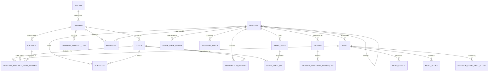

# ⚔️ Hashira Market DBMS: Demon Slayer Stock Trading Engine

[](https://www.mysql.com/)
[](https://www.python.org/)
[](LICENSE)
[](#)

> An enterprise-grade relational database management system modeled on the **Demon Slayer (Kimetsu no Yaiba)** universe. Blending financial stock trading mechanics with anime combat lore, the engine coordinates 21 normalized relations with advanced SQL analytics, ACID stored procedures, and an interactive terminal application.

---

## 📹 Video Demonstration & Submission Artifacts

- **Project Demonstration Video**: [Watch on Google Drive](https://drive.google.com/file/d/1rOES2vuShFr48wJTFIVukusdD6q2beME/view?usp=sharing)
- **Academic Course**: Data and Applications (DnA 2025) - Phase 4 Final Submission
- **Team Number**: Team 1
  - **Naveen** (`2024101065`)
  - **Nikila** (`2024101019`)
  - **Sharif** (`2024101035`)

---

## 🌟 Key SQL Capabilities Demonstrated

| SQL Capability | Implementation Highlights | File Location |
|---|---|---|
| **Analytical Window Functions** | `DENSE_RANK()`, `PERCENT_RANK()`, `ROW_NUMBER()`, running wealth totals across combat factions | [`sql/advanced_queries.sql`](sql/advanced_queries.sql) |
| **Common Table Expressions (CTEs)** | Multi-level `WITH` pipelines calculating portfolio ROI, yield %, and total net worth | [`sql/advanced_queries.sql`](sql/advanced_queries.sql) |
| **ACID Stored Procedures** | Pessimistic row locking (`FOR UPDATE`), balance checks, rollback handlers (`DECLARE EXIT HANDLER`) | [`sql/views_and_procedures.sql`](sql/views_and_procedures.sql) |
| **Database Triggers** | `AFTER UPDATE` automated audit logging (`AUDIT_COMPANY_MARKETCAP`), domain constraint enforcement | [`sql/views_and_procedures.sql`](sql/views_and_procedures.sql) |
| **High-Arity Relationships** | Full schema support for Ternary (`CASTS_SPELL_ON`) and Quaternary (`INVESTOR_PRODUCT_FIGHT_REWARD`) entities | [`sql/schema.sql`](sql/schema.sql) |
| **Relational Integrity** | Explicit referential actions (`ON DELETE CASCADE`, `ON DELETE SET NULL`, `ON UPDATE CASCADE`) | [`sql/schema.sql`](sql/schema.sql) |
| **Query Optimization** | Strategic indexing on high-frequency query paths and composite transaction lookups | [`sql/schema.sql`](sql/schema.sql) |

---

## 📐 Relational Schema Architecture

The database model is normalized through **3NF / BCNF**, eliminating partial and transitive functional dependencies.



*For complete schema specifications and documentation, see [`docs/ER_DIAGRAM.md`](docs/ER_DIAGRAM.md).*

---

## 🚀 Quickstart & Setup Guide

### 1. Prerequisites
- **MySQL Server** (8.0 or newer)
- **Python** (3.10 or newer)
- Git

### 2. Clone Repository & Install Python Dependencies
```bash
git clone https://github.com/naveen1232321/hashira-market-dbms.git
cd hashira-market-dbms
python -m pip install -r requirements.txt
```

### 3. Database Initialization
Log into MySQL and execute the schema and populate scripts:

```sql
mysql -u root -p
```
```sql
-- Create database, tables, and indexes
SOURCE sql/schema.sql;

-- Populate realistic Demon Slayer market data
SOURCE sql/populate.sql;

-- (Optional) Create analytical views, stored procedures & audit triggers
SOURCE sql/views_and_procedures.sql;
```

### 4. Configure Credentials
Copy `.env.example` to `.env` and set your MySQL credentials (or pass them via environment variables):
```ini
DB_HOST=localhost
DB_PORT=3306
DB_NAME=mini_world_db
DB_USER=root
DB_PASS=your_password_here
```

### 5. Launch the Application CLI
```bash
python src/main_app.py
```

---

## 💻 CLI Application Features

### 📖 Read Queries (R Menu)
1. **List All Investors**: Full roster of demon slayers and demons, wallets, win rates, and battle tallies.
2. **List Companies with Sector Info**: Corporate market caps matched with industry risk levels.
3. **List Stocks with Issuer Details**: Public ticker symbols, base prices, and corporate parents.
4. **Recent Fights & News Effects**: Recent combat outcomes and resulting equity volatility.
5. **View Investor Portfolio**: Detailed holding breakdown, share quantities, and purchase prices.
6. **Power Tier Leaderboard**: Faction-ranked combat tiers using `DENSE_RANK()` and `PERCENT_RANK()`.
7. **Portfolio Yield & Net Worth**: Multi-level CTE calculating cost basis, market value, and unrealized ROI %.
8. **Mentor-Mentee Synergy**: Self-join analyzing generational performance spreads and combined wealth.

### ✍️ Write Operations (W Menu)
1. **Insert Fight & Market News**: Atomic multi-table INSERT recording combat and generating immediate market news.
2. **Buy Stock**: Full financial execution—deducts investor wallet, creates a timestamped transaction record, and upserts the portfolio.
3. **Update Company MarketCap**: Adjusts corporate market cap and activates trigger-based audit logging.
4. **Delete Fight (with Cascade)**: Removes a battle record and proves `ON DELETE CASCADE` clearing related news events.

---

## 🎬 Video Demonstration Sequence (Phase 4 Verification)

To reproduce the exact demonstration flow from the submission video:

```
Part 1: Database Connection
  1. MySQL Terminal logged in.
  2. Launch Python CLI: python src/main_app.py

Part 2: Write Operations (Demonstrating Before / After state transitions)
  Write Op 1 - Insert Fight & News:
    - MySQL:  SELECT * FROM FIGHT WHERE FightID = 'F020'; (Empty)
    - Python: Select W -> 1, input sample data (F020, INV001, INV005, NEWS020)
    - MySQL:  SELECT * FROM FIGHT WHERE FightID = 'F020'; (Shows record)
    - MySQL:  SELECT * FROM NEWS_EFFECT WHERE NewsID = 'NEWS020'; (Shows generated news)

  Write Op 2 - Buy Stock:
    - MySQL:  SELECT Wallet FROM INVESTOR WHERE InvestorID = 'INV001'; (Before)
    - MySQL:  SELECT * FROM PORTFOLIO WHERE InvestorID = 'INV001' AND StockID = 'STK005'; (Before)
    - Python: Select W -> 2, execute purchase (INV001, STK005, Qty: 100, Price: 89.40)
    - MySQL:  SELECT Wallet FROM INVESTOR WHERE InvestorID = 'INV001'; (Debited)
    - MySQL:  SELECT * FROM PORTFOLIO WHERE InvestorID = 'INV001' AND StockID = 'STK005'; (Updated)
    - MySQL:  SELECT * FROM TRANSACTION_RECORD WHERE InvestorID = 'INV001' ORDER BY TransactionDate DESC LIMIT 1;

  Write Op 3 - Update MarketCap:
    - MySQL:  SELECT CompanyID, Name, MarketCap FROM COMPANY WHERE CompanyID = 'CMP001'; (Before)
    - Python: Select W -> 3, update CMP001 MarketCap to 6000000000.00
    - MySQL:  SELECT CompanyID, Name, MarketCap FROM COMPANY WHERE CompanyID = 'CMP001'; (Updated)

  Write Op 4 - Delete Fight (Cascade):
    - MySQL:  SELECT * FROM FIGHT WHERE FightID = 'F020'; (Present)
    - MySQL:  SELECT * FROM NEWS_EFFECT WHERE FightID = 'F020'; (Present)
    - Python: Select W -> 4, enter F020 and confirm 'DELETE'
    - MySQL:  SELECT * FROM FIGHT WHERE FightID = 'F020'; (Empty)
    - MySQL:  SELECT * FROM NEWS_EFFECT WHERE FightID = 'F020'; (Cascade-deleted)

Part 3: Read Queries
  - Execute queries 1 through 8 to verify data retrieval and analytical computations.
```

---

## 📂 Repository Organization

```
DNA_DBMS/
├── .github/
│   └── workflows/
│       └── ci.yml                     # Automated GitHub Actions test pipeline
├── docs/
│   ├── ER_DIAGRAM.md                  # Comprehensive ER model and entity documentation
│   ├── ADVANCED_SQL.md                # In-depth breakdown of SQL techniques and query plans
│   └── phases/                        # Course milestone reports (Phases 1, 2, 3, 4)
│       ├── Phase_1_Requirement_Analysis.pdf
│       ├── Phase_2_Conceptual_Design_ERD.pdf
│       ├── Phase_3_Relational_Mapping_Normalization.pdf
│       └── Phase_4_Implementation_Guidelines.pdf
├── sql/
│   ├── schema.sql                     # Full DDL with 21 tables, constraints & performance indexes
│   ├── populate.sql                   # Comprehensive seed dataset (20+ entities)
│   ├── advanced_queries.sql           # 12+ Production SQL analytics (CTEs, Window Functions, Matrix Pivoting)
│   └── views_and_procedures.sql       # Business views, ACID stored procedures & audit triggers
├── src/
│   ├── config.py                      # Environment configuration loader
│   ├── db.py                          # Connection handling & table formatting
│   ├── queries.py                     # Parameterized SQL query modules
│   ├── main_app.py                    # Enhanced interactive CLI application
│   ├── test_db.py                     # Automated test suite and schema validator
│   ├── schema.sql                     # Phase 4 submission mirror
│   └── populate.sql                   # Phase 4 submission mirror
├── .env.example                       # Environment configuration template
├── .gitignore                         # Standard git ignore rules
├── LICENSE                            # MIT License
├── README.md                          # Repository documentation
└── requirements.txt                   # Python dependencies (pymysql, tabulate, python-dotenv)
```

---

## 📜 License

This project is licensed under the [MIT License](LICENSE).

