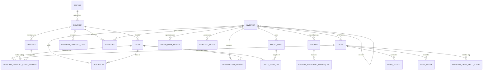

# Entity-Relationship (ER) Architecture & Relational Model

This document outlines the conceptual and relational schema design for the **Hashira Market DBMS**, a financial stock-trading ecosystem modeled on the Demon Slayer universe.

---

## 1. Relational Schema Architecture (Mermaid)

---

## 2. Relational Mapping Breakdown

### Strong Entities
1. **SECTOR** (`SectorID`, `Name`, `Description`, `RiskLevel`, `Created_Date`)
2. **INVESTOR** (`InvestorID`, `FirstName`, `LastName`, `Type`, `MentorID` [FK], `Wallet`, `JoinDate`, `TotalBattles`, `WinRate`)
3. **COMPANY** (`CompanyID`, `Name`, `CEO`, `Founded`, `Headquarters`, `MarketCap`, `SharesOutstanding`, `SectorID` [FK])
4. **PRODUCT** (`ProductID`, `Name`, `Type`, `PowerLevel`, `CompanyID` [FK], `Price`, `ReleaseDate`)
5. **STOCK** (`StockID`, `Symbol`, `Name`, `BaseValue`, `CompanyID` [FK], `IPODate`)
6. **FIGHT** (`FightID`, `Location`, `WinnerInvestorID` [FK], `LoserInvestorID` [FK], `SkillsUsed`, `ProductsUsed`)
7. **MAGIC_SPELL** (`SpellID`, `InvestorID` [FK], `Name`, `EffectType`, `Duration`, `CooldownPeriod`, `Description`)
8. **NEWS_EFFECT** (`NewsID`, `FightID` [FK], `WinnerType`, `Description`, `StockEffect`, `ImpactLevel`, `Timestamp`)
9. **TRANSACTION_RECORD** (`TransactionID`, `InvestorID` [FK], `StockID` [FK], `TransactionType`, `Quantity`, `PricePerShare`, `TransactionDate`, `TotalValue`)

### Subclasses (Specialization)
10. **HASHIRA** (`InvestorID` [PK, FK], `BreathingTechnique`, `RankLevel`, `Corps`)
11. **UPPER_RANK_DEMON** (`InvestorID` [PK, FK], `BloodArt`, `RankLevel`, `Corps`)

### Weak Entities
12. **INVESTOR_SKILLS** (`InvestorID` [PK, FK], `Skill` [PK], `SkillLevel`)
13. **FIGHT_SCORE** (`FightID` [PK, FK], `InvestorID` [PK, FK], `Score`, `Performance`, `Rewards`, `EffectDescription`)

### Multivalued Attributes
14. **HASHIRA_BREATHING_TECHNIQUES** (`InvestorID` [PK, FK], `Technique` [PK])
15. **COMPANY_PRODUCT_TYPE** (`CompanyID` [PK, FK], `ProductType` [PK])

### Many-to-Many (M:N) Relationships
16. **PORTFOLIO** (`InvestorID` [PK, FK], `StockID` [PK, FK], `Quantity`, `PurchasePrice`, `PurchaseDate`)
17. **PROMOTES** (`CompanyID` [PK, FK], `InvestorID` [PK, FK], `StartDate`, `EndDate`, `Role`)

### Ternary Relationship
18. **CASTS_SPELL_ON** (`CastID` [PK], `InvestorID` [FK], `SpellID` [FK], `StockID` [FK], `CastTimestamp`, `EffectDuration`, `PowerConsumption`)

### Quaternary Relationships
19. **INVESTOR_PRODUCT_FIGHT_REWARD** (`InvestorID` [PK, FK], `ProductID` [PK, FK], `FightID` [PK, FK], `StockID` [PK, FK], `RewardAmount`, `EffectDescription`)
20. **INVESTOR_FIGHT_SKILL_SCORE** (`InvestorID` [PK, FK], `FightID` [PK, FK], `Skill` [PK, FK], `SkillScore`)

### Audit Infrastructure
21. **AUDIT_COMPANY_MARKETCAP** (`AuditID` [PK], `CompanyID` [FK], `OldMarketCap`, `NewMarketCap`, `ChangedAt`, `ChangedBy`)

---

## 3. Normalization Verification
- **1NF**: All attributes are atomic; multivalued attributes (`BreathingTechnique`, `ProductType`) are segregated into dedicated decomposition relations.
- **2NF**: All non-key attributes are fully functionally dependent on candidate keys. Composite primary keys in weak entities and M:N tables do not possess partial dependencies.
- **3NF & BCNF**: Transitive dependencies have been eliminated; all determinants are candidate keys.

